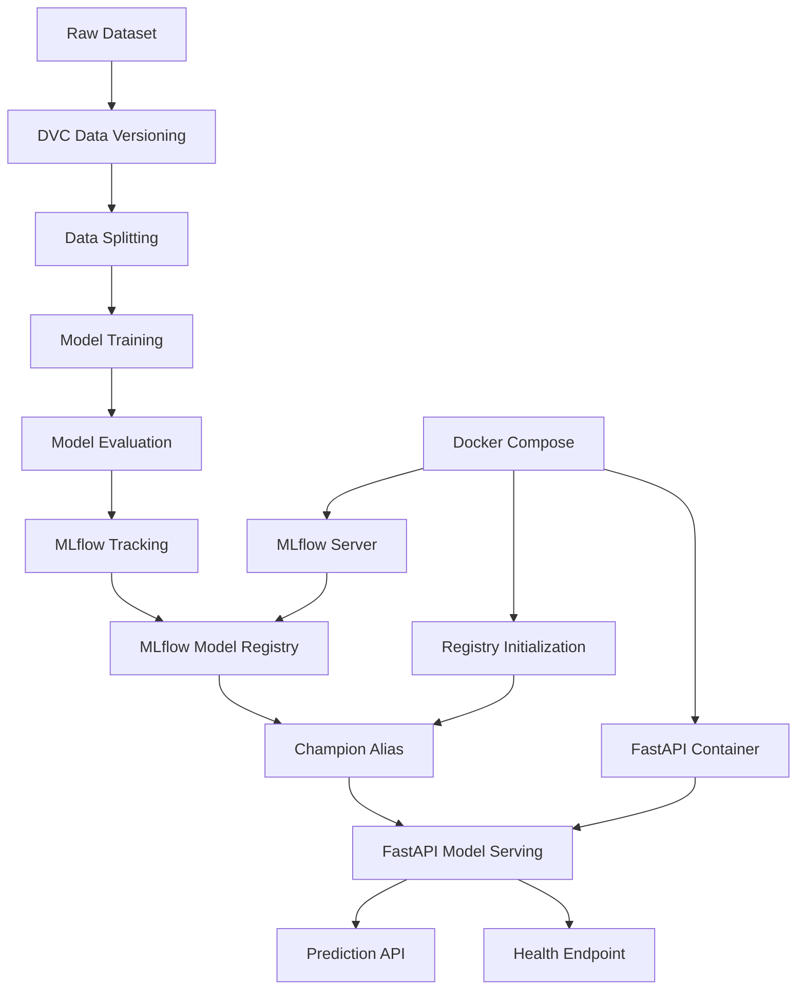

# MLOps Lab — End-to-End Machine Learning Lifecycle

An end-to-end MLOps project demonstrating data versioning, reproducible ML pipelines, experiment tracking, model registry management, and containerized model serving.

The project uses the Breast Cancer Wisconsin dataset to build and deploy a classification model while exploring practical MLOps engineering workflows.

## Project Overview

This repository demonstrates how to move a machine learning model from experimentation to a reproducible and deployable service.

The project currently covers:

- Data versioning and pipeline management with DVC
- Reproducible model training and evaluation
- Experiment tracking with MLflow
- Model registration and version management
- Model alias management using MLflow Model Registry
- REST API development with FastAPI
- Containerized services using Docker and Docker Compose
- Automated API testing with Pytest

The primary objective is to build a modular and reproducible ML workflow that can gradually evolve toward a production-oriented deployment architecture.

## Architecture



### Main Components

| Component | Responsibility |
|---|---|
| DVC | Dataset versioning and reproducible ML pipelines |
| scikit-learn | Model training and evaluation |
| MLflow Tracking | Experiment and artifact tracking |
| MLflow Model Registry | Model versioning and aliases |
| FastAPI | REST API and model inference |
| Docker | Application containerization |
| Docker Compose | Multi-service orchestration |
| Pytest | Automated API tests |
| uv | Python dependency and environment management |

## Project Structure

```text
mlops-lab/
│
├── data/
│   ├── raw.csv.dvc
│   └── processed/
│       ├── train.csv
│       └── test.csv
│
├── models/
│   └── model.joblib
│
├── reports/
│   ├── confusion_matrix.png
│   └── metrics.json
│
├── src/
│   ├── api.py
│   ├── prepare_data.py
│   ├── split_data.py
│   ├── train_model.py
│   ├── evaluate_model.py
│   ├── train_with_mlflow.py
│   ├── manage_registry.py
│   └── initialize_registry.py
│
├── tests/
│   └── test_api.py
│
├── Dockerfile
├── compose.yaml
├── dvc.yaml
├── dvc.lock
├── params.yaml
├── pyproject.toml
├── uv.lock
└── requirements-model.txt
```

Generated datasets, model artifacts, MLflow storage, and local environment files are excluded from Git where appropriate.

## Getting Started

### Prerequisites

Install the following tools:

- Python 3.12+
- Git
- uv
- Docker Engine
- Docker Compose

### 1. Clone the Repository

```bash
git clone <YOUR_REPOSITORY_URL>
cd mlops-lab
```

### 2. Install Dependencies

```bash
uv sync
```

This installs the project dependencies, including the development tools required for DVC and testing.

### 3. Retrieve the Dataset

The raw dataset is managed through DVC.

```bash
uv run dvc pull
```

A working DVC remote must be configured and accessible. The current development setup uses local storage, so a fresh clone requires access to the corresponding remote or another configured source of the dataset.

## DVC Pipeline

The project defines a three-stage pipeline in `dvc.yaml`.

### Pipeline Stages

**1. Data Splitting**

```bash
uv run python src/split_data.py
```

Splits the dataset into training and testing datasets.

**2. Model Training**

```bash
uv run python src/train_model.py
```

Trains a Random Forest classifier using parameters defined in `params.yaml`.

**3. Model Evaluation**

```bash
uv run python src/evaluate_model.py
```

Evaluates the trained model and generates evaluation artifacts.

### Run the Complete Pipeline

```bash
uv run dvc repro
```

### Inspect Pipeline Metrics

```bash
uv run dvc metrics show
```

The pipeline tracks:

- Training and testing datasets
- Model artifacts
- Evaluation metrics
- Confusion matrix visualization

The evaluation metrics are stored in `reports/metrics.json`.

## MLflow Experiment Tracking

MLflow is used to track model experiments, parameters, metrics, and artifacts.

The project integrates MLflow into the model training and evaluation workflows.

Tracked information includes:

- Model hyperparameters
- Evaluation metrics
- Confusion matrix
- Model artifacts
- Model signatures
- Model dependencies

The model is registered under:

```text
breast-cancer-classifier
```

### Model Registry and Aliases

The project uses MLflow Model Registry to manage model versions.

The API loads the model through the `champion` alias:

```text
models:/breast-cancer-classifier@champion
```

This separates model selection from application code. The model version assigned to the alias can change without modifying the API implementation.

The registry initialization script checks whether the alias already exists. If it does, the existing assignment is preserved. Otherwise, the latest READY model version is assigned.

## FastAPI Model Serving

The application exposes two main endpoints.

| Method | Endpoint | Description |
|---|---|---|
| GET | `/health` | Returns application and loaded model information |
| POST | `/predict` | Generates a classification prediction |

### Health Check

```http
GET /health
```

Example response:

```json
{
  "status": "healthy",
  "model_name": "breast-cancer-classifier",
  "model_version": "3",
  "model_alias": "champion"
}
```

The model version shown above is an example from the current development environment.

### Prediction

```http
POST /predict
```

Request structure:

```json
{
  "features": {
    "feature_name_1": 1.23,
    "feature_name_2": 4.56
  }
}
```

The actual request must contain all expected feature names from the registered model signature, with no missing or additional features.

The API validates:

- Missing features
- Unexpected features
- Non-finite numeric values
- Feature ordering

The prediction response includes the predicted class, readable label, model name, model version, and alias.

Class mapping:

| Prediction | Label |
|---|---|
| 0 | Benign |
| 1 | Malignant |

Interactive API documentation is available at:

```text
http://localhost:8000/docs
```

## Docker Compose Deployment

The application uses Docker Compose to orchestrate three services:

| Service | Description | Port |
|---|---|---|
| MLflow | Tracking server and model registry | 5000 |
| Registry Init | Initializes the champion alias when needed | Internal |
| API | FastAPI inference service | 8000 |

All three services use the same application image.

### Important: Required MLflow State

The current Compose configuration mounts the local MLflow SQLite database and artifact directory:

```text
./mlflow.db
./mlartifacts/
```

These are runtime data and are not committed to Git.

Consequently, a fresh clone must first be supplied with a compatible MLflow database, registered model, and corresponding artifacts before the complete Compose stack can start successfully.

### Build and Start Services

After preparing the required MLflow state:

```bash
docker compose up --build -d
```

### Inspect Service Status

```bash
docker compose ps -a
```

### View Logs

```bash
docker compose logs -f
```

Or inspect individual services:

```bash
docker compose logs -f api
docker compose logs -f mlflow
```

### Stop Services

```bash
docker compose down
```

### Access the Services

- FastAPI: http://localhost:8000
- API Documentation: http://localhost:8000/docs
- MLflow UI: http://localhost:5000

## Testing

The API is covered by automated tests using Pytest and FastAPI TestClient.

Run the test suite:

```bash
uv run pytest tests/ -v
```

Current test coverage includes:

- Health endpoint
- Valid prediction requests
- Missing features
- Extra features
- NaN values
- Infinite values

The current test suite contains six passing tests.

## Development Roadmap

The project is under active development. Planned improvements include:

- [ ] Configure a portable DVC remote
- [ ] Integrate MinIO for S3-compatible object storage
- [ ] Improve experiment selection using separate training, validation, and test datasets
- [ ] Add model performance monitoring with Prometheus
- [ ] Implement CI workflows using GitHub Actions
- [ ] Automate Docker image builds
- [ ] Implement continuous deployment
- [ ] Improve model lifecycle and deployment automation

## Design Principles

This project follows several engineering principles:

- Reproducibility over manual experimentation
- Explicit dependency management
- Separation of development and production dependencies
- Versioned data and models
- Configuration-driven model selection
- Automated validation and testing
- Containerized application deployment

## License

No license has been specified yet.